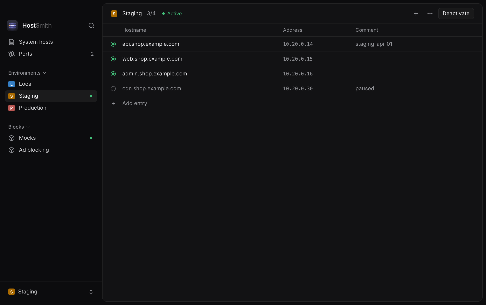

<p align="center">
  
</p>

<h1 align="center">HostSmith</h1>

<p align="center">
  A small macOS app for switching <code>/etc/hosts</code> environments and seeing which ports are in use.
</p>



HostSmith keeps environments such as Local, Staging and Production as tagged
blocks in `/etc/hosts` and switches between them in one write. It also lists
listening ports by project and stops the ones you no longer need. Built with
Tauri, Rust and React.

## Install

```bash
brew install --cask twan-nguyen/tap/hostsmith
```

Coming from Hosven 1.x: uninstall it first. HostSmith copies your profiles from
`~/.config/hosven` on first launch.

## Development

You need macOS 15 or later, Rust, Node.js and pnpm.

```bash
pnpm install
pnpm tauri dev
```

## License

MIT
