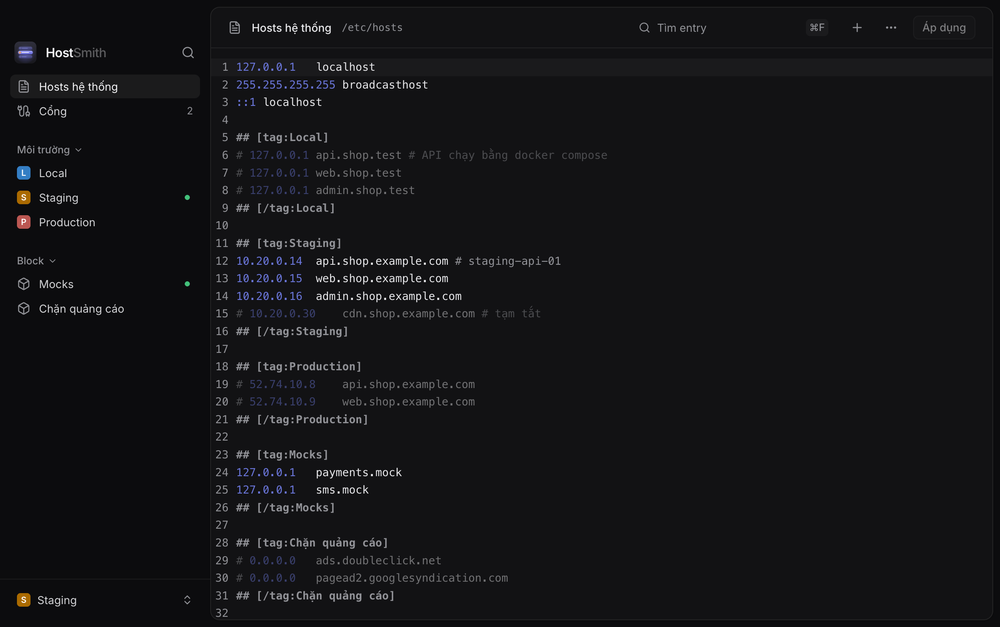
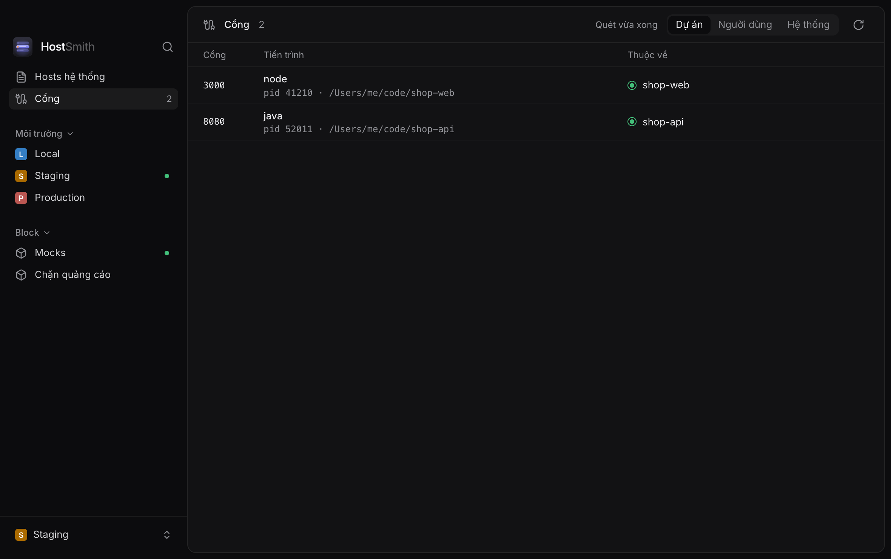

<p align="center">
  
</p>

<h1 align="center">HostSmith</h1>

<p align="center">
  Ứng dụng macOS quản lý <code>/etc/hosts</code> và các cổng đang chạy cho developer.
</p>

<p align="center">
  
</p>

## Tính năng

- **Môi trường và block** trong `/etc/hosts`. Mỗi profile là một block `## [tag:Tên]`. Bật một môi trường sẽ tắt các môi trường khác và ghi file trong cùng một lần; block thì bật tắt độc lập. Từng entry bật tắt riêng được. ⌘1–⌘9 đổi môi trường, ⌘0 tắt.
- **Hosts hệ thống.** Sửa thẳng `/etc/hosts` trong trình soạn thảo có tô màu, chỉ ghi khi bấm "Áp dụng". Có lệnh sao lưu file hiện tại.
- **Ghi an toàn.** Chỉ hỏi mật khẩu quản trị một lần trong vài phút, tự xoá cache DNS, rồi kiểm tra các hostname vừa ghi đã phân giải đúng chưa. Khi `/etc/hosts` bị công cụ khác sửa, HostSmith báo và chờ bạn tải lại thay vì ghi đè.
- **Cổng.** Liệt kê các cổng TCP đang lắng nghe, cho biết tiến trình thuộc dự án nào (thư mục gần nhất có `.git` trong thư mục home) hay container nào. Mặc định chỉ hiện cổng của dự án; bộ lọc "Người dùng" hiện mọi cổng không phải dịch vụ hệ thống, "Hệ thống" hiện riêng các dịch vụ đó. Dừng bằng SIGTERM rồi SIGKILL nếu cần, luôn hỏi trước.
- **Menu bar** để đổi môi trường, bật nhanh block và xem cổng đang dùng mà không cần mở cửa sổ.
- **⌘K** tìm profile và lệnh, **⌘,** mở cài đặt.
- **URL scheme** `hostsmith://` cho script và launcher:
  - `hostsmith://activate/<profile>`, `hostsmith://deactivate`
  - `hostsmith://ports`

<p align="center">
  
  
</p>

## Cài đặt

```bash
brew install --cask twan-nguyen/tap/hostsmith
```

Cập nhật: `brew upgrade --cask hostsmith`.

App được ký ad-hoc và không notarize. Cask tự gỡ cờ quarantine; nếu tải file zip bằng trình duyệt thì chạy `xattr -dr com.apple.quarantine /Applications/HostSmith.app`.

Đến từ Hosven 1.x: gỡ Hosven rồi cài HostSmith bằng lệnh trên. Lần chạy đầu, HostSmith chép profile và cài đặt từ `~/.config/hosven`. Bản 2.0 bỏ trình sửa file `.env` và không tự cập nhật nữa.

## Dữ liệu

HostSmith lưu cấu hình dạng văn bản trong `$XDG_CONFIG_HOME/hostsmith` hoặc `~/.config/hostsmith`, nên có thể đưa vào dotfiles:

- `profiles.json`: màu, phím tắt và loại của từng profile.
- `settings.json`: giao diện, cỡ chữ, menu bar, độ trong suốt.

## Build từ source

Yêu cầu: macOS 15+, Rust (stable), Node 22 và pnpm.

```bash
pnpm install
pnpm tauri dev
```

Kiểm thử: `pnpm test` và `cd src-tauri && cargo test`. Đường dẫn `hostsmith://` chỉ hoạt động với app đã cài trong `/Applications`, không chạy với `pnpm tauri dev`.

Build bản phát hành: xem [PUBLISHING.md](PUBLISHING.md).

## Giấy phép

MIT
